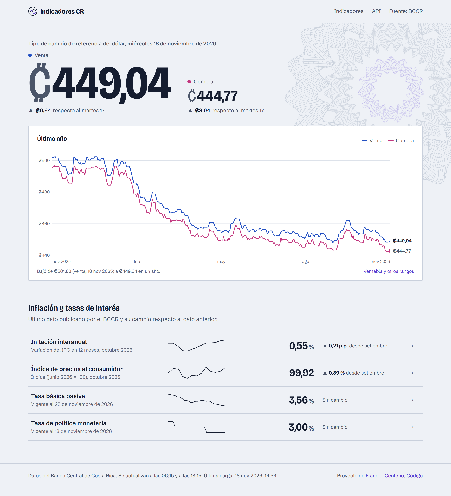
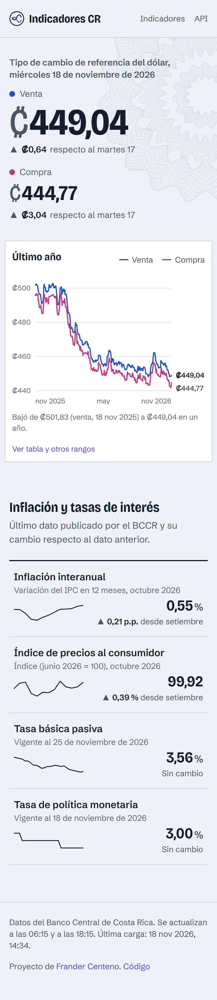
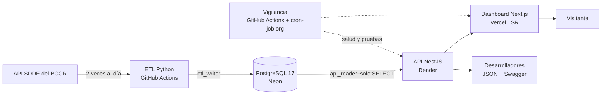

# pipeline-indicadores-cr

[](https://github.com/Frandercc1234/pipeline-indicadores-cr/actions/workflows/ci.yml)
[](https://github.com/Frandercc1234/pipeline-indicadores-cr/actions/workflows/etl-diario.yml)
[](https://github.com/Frandercc1234/pipeline-indicadores-cr/actions/workflows/vigilancia.yml)

Pipeline diario de indicadores económicos del Banco Central de Costa Rica (BCCR), con una API pública de solo lectura y un dashboard.

Un proceso corre solo dos veces al día: baja seis indicadores de la API SDDE del BCCR, los valida, los guarda en PostgreSQL y los expone por una API NestJS y un dashboard Next.js. El historial va desde 2015.

| | URL |
|---|---|
| Dashboard | https://pipeline-indicadores-cr.vercel.app |
| API | https://pipeline-indicadores-cr.onrender.com |
| Swagger | https://pipeline-indicadores-cr.onrender.com/docs |

> La API corre en el plan gratuito de Render: si estuvo dormida, el primer pedido puede tardar unos 30 s. El dashboard sigue sirviéndose por ISR aunque la API tarde.

| Inicio (1280 px) | Inicio (375 px) |
|---|---|
|  |  |

Detalle de un indicador: [1280 px](docs/capturas/detalle-1280.png) y [375 px](docs/capturas/detalle-375.png).

## Indicadores

| slug | Indicador | Código BCCR |
|---|---|---|
| `tc_compra` | Tipo de cambio de referencia, compra | 317 |
| `tc_venta` | Tipo de cambio de referencia, venta | 318 |
| `ipc_indice` | Índice de precios al consumidor, base junio 2026 = 100 | 98404 |
| `ipc_interanual` | Variación interanual del IPC | 98407 |
| `tbp` | Tasa básica pasiva | 423 |
| `tpm` | Tasa de política monetaria | 3541 |

## Arquitectura



- **ETL** (`etl/`): Python 3.12. Cliente con reintentos, validaciones por fila, upsert con registro de revisiones y comparación posterior contra la fuente. Con `BCCR_MODO=simulado` lee fixtures reales y nunca llama al BCCR.
- **Base** (`db/`): migraciones SQL versionadas. Roles separados: `etl_writer` (sin `DELETE` ni DDL) y `api_reader` (solo `SELECT`).
- **API** (`api/`): NestJS 11, solo `GET`, Swagger, 60 peticiones por minuto por IP.
- **Web** (`web/`): Next.js 16, Tailwind 4 y Recharts. Diseño "papel de seguridad" en `docs/diseno/`.
- **E2E** (`e2e/`): Playwright a 375 y 1280 px, en local, después de cada deploy y cada hora contra producción.

## Endpoints de la API

Todos son `GET`. El detalle de cada uno está en [Swagger](https://pipeline-indicadores-cr.onrender.com/docs).

| Ruta | Devuelve |
|---|---|
| `/indicadores` | Los seis indicadores con su último valor y el anterior |
| `/indicadores/:slug` | Un indicador |
| `/indicadores/:slug/serie?desde=&hasta=` | Serie por fechas (`YYYY-MM-DD`) |
| `/salud` | Estado de la base y de la última carga diaria (503 si hay más de 36 h sin carga) |
| `/salud/vivo` | Responde sin tocar la base; incluye el commit desplegado |

```bash
curl -s https://pipeline-indicadores-cr.onrender.com/indicadores/tc_venta
```

## Correrlo en local

Requisitos: Docker, Node 24 y Python 3.12. Copiá `.env.example` a `.env` y poné contraseñas locales propias; nada de eso se sube al repo.

```bash
docker compose up -d --build db api
```

Cargar datos simulados (sin token del BCCR):

```bash
docker compose --profile etl run --rm -e BCCR_MODO=simulado etl diario
```

Dashboard:

```bash
cd web && npm ci && API_URL=http://127.0.0.1:3001 npm run dev
```

## Pruebas

| Qué | Comando |
|---|---|
| ETL, unitarias | `cd etl && BCCR_MODO=simulado pytest tests/unit -q` |
| ETL, datos (necesita la base) | `cd etl && BCCR_MODO=simulado pytest tests/datos -q` |
| API, unitarias y e2e | `cd api && npm test && npm run test:e2e` |
| Web, lint y build | `cd web && npm run lint && npm run build` |
| Playwright | `cd e2e && URL_WEB=http://127.0.0.1:3000 URL_API=http://127.0.0.1:3001 npx playwright test` |

## Automatización

| Workflow | Cuándo | Qué hace |
|---|---|---|
| `ci.yml` | Push y pull request | gitleaks, ETL, API, web, imágenes Docker y Playwright local |
| `etl-diario.yml` | 06:15 y 18:15 hora de Costa Rica | Carga los últimos 60 días, valida contra el BCCR y abre un issue si falla |
| `post-deploy.yml` | Push a `main` | Espera el commit nuevo en Vercel (y en Render si cambió `api/`) y corre Playwright en producción |
| `vigilancia.yml` | Cada 10 min, cada hora y cada mes | Latido a la API, `/salud`, antigüedad del ETL y pruebas en producción; reactiva los workflows |
| `migrar.yml`, `etl-backfill.yml` | Manual | Migraciones y carga histórica en Neon |

## Decisiones

- **Sin ORM.** Tres tablas de lectura se resuelven con SQL parametrizado y `pg`.
- **Nunca se rellenan huecos.** Si el BCCR no publicó una fecha, no existe en la base. Los huecos largos se anotan como advertencia.
- **Correcciones del BCCR.** `diario` vuelve a pedir 60 días; si un valor cambia, se guarda el anterior en `revision`.
- **Adelanto de publicación por indicador** (`dias_adelanto`): tipos de cambio 1 día, TBP 10 días, el resto 0. Una fecha más allá de ese límite se rechaza y la carga queda `parcial`.
- **IPC base junio 2026** (códigos 98404 y 98407). Si el BCCR publica otra base, se cambia el código en `etl/indicadores.yaml` y se repite el backfill de esos dos.
- **Render solo redespliega cuando cambia `api/`**, por eso `/salud/vivo` puede mostrar un commit anterior al último push.
- **Los crons de GitHub se retrasan o se saltan.** Dos cargas al día con ventana de 60 días, `/salud` en 503 tras 36 h sin carga y una revisión horaria que avisa si la última corrida programada tiene más de 18 h.
- **Render se dormía** porque el ping de GitHub Actions es demasiado irregular. Un ping externo gratuito (cron-job.org, cada 5 min a `/salud/vivo`) lo mantiene despierto; `/salud/vivo` no toca la base, así que Neon se suspende igual. El cron de GitHub queda como respaldo.
- **Sin claves en el código.** `.env*` fuera del repo, gitleaks en CI y roles de base con mínimo privilegio.

## Fuente

Datos del [Banco Central de Costa Rica](https://www.bccr.fi.cr), servicio de Indicadores Económicos (API SDDE). Verificación manual contra sdd.bccr.fi.cr en [`docs/validacion-manual.md`](docs/validacion-manual.md); versiones exactas en [`docs/versiones.md`](docs/versiones.md).

Proyecto de Frander Centeno.
